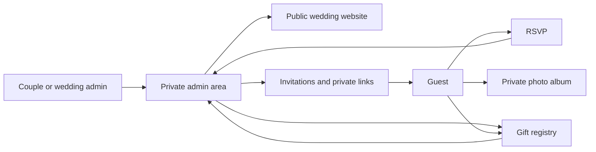
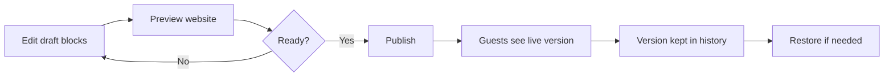
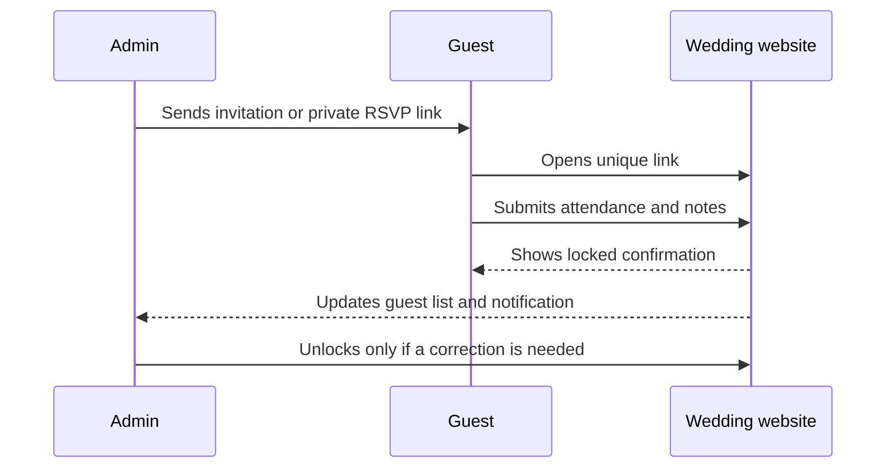
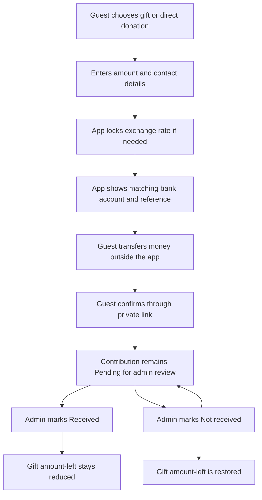

# Ìgbéyàwówa — product and QA guide

This guide explains the app in plain English. It is for QA testers, product
reviewers, customer-support teams, and anyone who needs to understand what the
product should do without reading the code.

For engineering status and historical decisions, see
[Product progress](./progress.md).

## The product in one minute

Ìgbéyàwówa helps a couple create and manage a wedding website. The couple's
team uses a private admin area to design the site, invite guests, collect
RSVPs, share private photos, and manage a gift registry. Guests use private
links and do not need an account.

The current version supports **one wedding per deployment**. It is not yet a
single platform where many unrelated couples create their own websites.

## Where to test (demo vs production)

Use **Demo** for almost all QA. Use **Production** only for final live checks
with real couple data, never for inventing test guests or fake payments.

| Environment                 | Purpose                                      | URL                                                |
| --------------------------- | -------------------------------------------- | -------------------------------------------------- |
| **Demo** (preferred for QA) | Safe cloud testing, new features, regression | [demo.igbeyawowa.app](https://demo.igbeyawowa.app) |
| **Production**              | Live couple website                          | [www.igbeyawowa.app](https://www.igbeyawowa.app/)  |

Notes for testers:

- Demo and production are **separate** deployments with separate databases.
  Changes on demo do not appear on production, and the reverse is also true.
- Open the landing page for that environment and use the site’s admin entry
  point when you need to sign in. Admin login is email + one-time code; only
  authorized emails can request a code.
- Prefer the custom demo URL above. Older Vercel links such as
  `*.vercel.app` may still open the same demo app; treat them as backups only.
- On demo, use fictional names and non-sensitive contact details.
- On production, do not create throwaway guests, upload junk photos, or run
  fake registry contributions.

## Who uses the app?

### Super admin

The owner or lead operator of the deployment. A super admin can use all wedding
management features and can also invite or remove other admins, review product
feedback, and receive support requests.

More than one production super admin can be configured. Their email addresses
are stored as a comma-separated server setting.

### Admin

A member of the couple's trusted team. Admins can manage wedding content,
guests, media, registry information, and settings. They cannot manage the
super-admin-only backlog or remove the protected super-admin accounts.

### Guest

An invited person. A guest does not sign in. They open private links to RSVP or
view an album. They may also browse the public wedding site and contribute
toward a gift.

### Website visitor

Anyone who knows the public wedding URL. A visitor can see published content
and the public registry. Private RSVP and album pages still require their
unique links.

## Status guide

- **Core and available** — part of the main product and implemented.
- **Extra and available** — useful polish or operational support, but not
  required for the basic wedding journey.
- **Planned** — agreed direction, not available yet.
- **Needs a decision** — product behaviour must be agreed before more code is
  written.

## Core features

### 1. Admin sign-in and first-time setup

Admins sign in with a one-time code sent by email; there is no admin password
to remember. If no wedding exists yet, the super admin is guided through
setting up the first wedding.

During setup, the app creates the wedding and its starting page content. The
admin can then invite trusted collaborators.

What QA should check:

- A known admin can request a code and sign in.
- An unknown email does not gain admin access.
- A first-time deployment opens onboarding instead of an empty dashboard.
- A normal admin cannot use super-admin-only controls.
- Signing out removes access to protected admin pages.

### 2. Wedding settings and design

Admins can manage the couple's names, wedding date, venue, announcement bar,
dress code, public
URL, invitation-card design, and public theme.

There are four public themes:

- **Celeste** — powder blue, navy, ivory, and champagne.
- **Botanica** — sage, cream, navy, and champagne.
- **Rosewater** — blush, dusty rose, cream, and champagne.
- **Nocturne** — deep navy with blue and yellow accents.

Each public theme supports light and dark display modes. The admin console has
its own appearance and should not inherit the public site's theme.

Important date rule: saving a wedding date does not automatically announce it.
The date remains private until an admin explicitly publishes it. The admin may
then notify previously invited guests.

What QA should check:

- Couple names and other saved details appear in the correct public places.
- The wedding still works when no date has been entered.
- Theme previews and the published website agree.
- Light/dark mode stays readable and does not alter the admin console.
- A saved but unpublished date is not shown publicly.
- Publishing the date and sending notifications are clear, separate actions.

### 3. Page content and publishing

Admins build the public website from sections, called blocks. Supported content
includes:

- hero banner;
- story;
- rich text;
- responsive image;
- responsive video;
- event details;
- gift registry.

Blocks can be added, edited, duplicated, removed, and reordered. Admins work on
a draft, preview it, and publish when ready. Previous published versions can be
restored. **Add item** opens a visual block picker; choosing a block opens it
and confirms what the new block is for.

Rich text supports limited wedding-safe formatting such as smaller headings,
lists, quotes, links, and alignment. Pasted content is cleaned so it cannot
silently override the site's fonts, colours, or security rules.

What QA should check:

- Reordering blocks changes the public page order after publishing.
- Draft changes do not leak onto the live site.
- Every block picker card has a useful visual preview and description.
- Block titles create sensible in-page navigation labels.
- Desktop/mobile images and videos use the mobile upload when available and
  otherwise fall back to desktop.
- Uploaded images retain a useful crop and open in the full-screen viewer.
- Unsafe or heavily styled pasted text is reduced to the supported formatting.
- Restoring a previous version produces the expected draft/live content.

### 4. Guests, invitations, and RSVP

Admins can add, edit, search, and remove guests. A guest record can include a
household, private notes, and a number of allowed additional attendees.
Duplicate names are flagged so the admin can confirm whether they represent
different people.

Invitations can be sent individually or in bulk by email. Admins can also share
through WhatsApp or copy the guest's private RSVP link.

The RSVP page lets the guest:

- say whether they will attend;
- confirm the number attending within their allowance;
- add dietary information;
- leave a message for the couple.

After submission, the response is locked to avoid accidental changes. An admin
can unlock it when a correction is needed. RSVP closes when the wedding is
marked completed.

What QA should check:

- Each guest's link opens the correct guest record.
- Attendance count cannot exceed the allowed guest total.
- Required fields and invalid email addresses show understandable errors.
- A submitted RSVP cannot be silently changed by the guest.
- Unlocking restores editing for the intended guest only.
- Email, WhatsApp, and copied-link actions use the correct guest.
- WhatsApp text includes website and date when available (parity with email).

### 5. Media library and private albums

Admins can upload several images, monitor per-file progress, retry failures,
and remove unwanted media. They can create private albums, add or remove
photos, and assign access to guests.

Albums can be shared by email, general link, personal guest link, or QR code.
The app records opens so admins can understand whether a shared link was used.
Photos open in a full-screen viewer without stretching or cropping the original
image.

What QA should check:

- A failed file does not hide successful files in the same upload batch.
- An empty album looks empty and does not borrow an unrelated library image.
- Removing a photo from an album does not remove the wrong media item.
- A guest sees only the album available through their link.
- Revoked or invalid links do not reveal private photos.
- Portrait and landscape images fit inside the full-screen viewer.

### 6. Gift registry and contributions

Admins can create gifts with an image, title, optional product link, and prices
in one or more currencies. They can add bank accounts for the currencies they
accept.

A guest can:

1. contribute toward a particular gift; or
2. make a direct donation that is not tied to a gift.

The app does **not** move money. It shows the correct bank details and a unique
reference so the guest can make a bank transfer outside the app.

When currencies differ, the app fetches an exchange rate and locks that rate to
the contribution. Later rate changes do not rewrite the historical amount. A
guest confirms that they sent the transfer through a private confirmation
link. The admin then audits the contribution as **Pending**, **Received**, or
**Not received**.

If a guest does not confirm, the app can send up to three reminders on
different days. Confirmation shows a thank-you page and sends a thank-you
email. The visual celebration is skipped when the visitor prefers reduced
motion.

Amazon on a gift is **optional**. A gift with only a title and price still works
via **Send money**. Admins may also add an Amazon listing and manually record an
Amazon purchase. There is no Amazon API connection or automatic order tracking.
The Amazon field accepts an **amazon.com wedding registry Share, registry, or
guest-view link**, not a normal product `dp` page. Guests open the whole list
and find the gift by title. See [Gift registry](./gift-registry.md#add-an-amazon-link-to-a-gift-optional)
for the exact steps.

Live FX uses public rate APIs (no Vercel env key). When rates fail for a
cross-currency payment, the guest must see an unavailable alert — never a fake
1:1 conversion.

What QA should check:

- A gift without Amazon shows **Send money** only.
- A gift with Amazon + price shows **Buy on Amazon** and **Send money**.
- Multiple same-currency bank accounts require an explicit guest choice.
- Changing pay currency refreshes the FX equivalent (or shows unavailable).
- The selected contribution currency has a matching enabled bank account.
- The bank details and unique reference belong to the contribution just made.
- A contribution is not counted twice when confirmation is opened again.
- Gift amount-left uses the locked exchange rate, not today's rate.
- Direct donations do not reduce a specific gift.
- Marking a contribution Not received restores the gift amount.
- Editing the paid amount recalculates the gift total consistently.
- Reminder and thank-you emails contain the correct private link.
- Reduced-motion mode receives the message without confetti.

## Extra features already available

These features improve operations and experience but are not required for the
shortest create-invite-RSVP journey:

- In-app admin notification bell with unread state, relevant-work links, and a
  **View all notifications** page containing both read and unread history.
- Append-only activity history with filters for area, actor, email, and date.
- Product feedback form and a super-admin feedback backlog.
- Regular-admin support email with an optional screenshot.
- Generated invitation-card artwork and themed invitation emails.
- QR-code sharing for private photo albums.
- Lightboxes for public and private images.
- A design showcase page for reviewing visual components.
- Privacy and cookie-information pages.
- Optional PayPal donation prompt supporting the product itself; this is
  separate from the couple's gift registry.

## Planned and future features

### Planned next

- **Super-admin import/export:** move a wedding between environments, including
  content, media references, settings, guests, and registry data.
- **Wedding status decision:** decide whether the current manual status remains,
  becomes automatic, or is removed. Today, Completed closes RSVP.

### Useful additions under discussion

- More descriptive plus-one policies instead of only a number.
- Choosing an existing Media image while editing Page Content.
- More public-site motion, while respecting reduced-motion settings.

### Future platform direction

- Many weddings managed from one platform.
- Per-wedding domains or expanded routing.
- More typography choices.
- Subscription or freemium plans.
- Wedding-party content block.
- Admin suspension and account/seat limits.
- A full support-ticket inbox.

These items should not be reported as defects in the current version unless a
release specifically promises them.

## FAQ from recent QA notes

### Where does “RSVP now” go?

There is no “RSVP now” control on **Set up your wedding** (onboarding). That
button appears in **guest invitation emails**. It opens the guest’s private
RSVP link (`/rsvp/…`). Only that invited guest should use it.

The RSVP email mock inside the theme picker uses a placeholder link
(`example.com`) and is preview-only — it does not send mail or open a real
RSVP page.

### Do users get an email when a guest RSVPs?

The couple/admins get an **in-app notification** (and an Activity row) when a
guest submits an RSVP. The product does not currently send a separate “guest
RSVPed” email to the couple. Guests receive invitation/reminder/thank-you
emails on their own flows (invite, registry confirm, and so on).

### View website and Preview website

**View website** in the sidebar and Overview opens the live published site.
**Preview website** appears only on Page content and opens the saved draft for
the signed-in admin. If the public slug is missing, the live-site action
becomes **Set public URL** instead. Prefer Demo for testing:
[demo.igbeyawowa.app](https://demo.igbeyawowa.app).

## Important limits and expectations

- One deployment manages one wedding.
- Guests do not create accounts.
- The app does not process card payments.
- Bank transfers happen outside the app.
- Amazon purchases are recorded manually; there are no Amazon webhooks.
- A wedding date is optional and must never be invented.
- The public site shows published content, not unfinished drafts.
- RSVP and photo links are private bearer links: anyone who receives the exact
  link may be able to use it, so testers should not post them publicly.
- Privacy and cookie text is product copy, not a substitute for legal review.
- Production ([www.igbeyawowa.app](https://www.igbeyawowa.app/)) should not be
  filled with QA test data. Use the cloud demo at
  [demo.igbeyawowa.app](https://demo.igbeyawowa.app).

## Recommended QA smoke test

Run this on **Demo**:
[demo.igbeyawowa.app](https://demo.igbeyawowa.app).

Use fictional people and non-sensitive information. Do not run this smoke test
on production.

### Admin journey

1. Sign in as the super admin using the emailed code.
2. Complete onboarding if the environment has no wedding.
3. Save names and venue without a date; confirm the app remains usable.
4. Choose a public theme and review light and dark modes.
5. Add or edit several page blocks, preview the draft, then publish it.
6. Invite a normal admin and confirm their permissions are narrower.

### Guest and RSVP journey

1. Create two guests with similar names and confirm duplicate handling is clear.
2. Send one invitation and copy another guest's link.
3. Submit an attending RSVP with dietary information.
4. Confirm the RSVP is locked.
5. Unlock it as an admin, edit it once, and confirm the admin list updates.

### Media journey

1. Upload portrait and landscape images together.
2. Create an album, add selected images, and assign a guest.
3. Open both a general share and a personal share.
4. Remove one image and confirm the remaining album is correct.
5. Revoke a share and verify it no longer exposes the album.

### Registry journey

1. Create a gift with two currency prices and matching bank accounts.
2. Start a contribution in one currency and note its reference.
3. Confirm it through the private link.
4. Check the amount-left and Pending audit entry.
5. Mark it Not received and verify the amount returns.
6. Mark it Received again and verify the amount is applied.
7. Make a direct donation and confirm it does not alter the gift.
8. Record an Amazon purchase manually and verify it is labelled separately.

### Operational journey

1. Confirm meaningful actions appear in Activity.
2. Confirm the notification bell receives and opens a relevant update.
3. Submit feedback from inside a side drawer and verify the modal remains
   clickable without closing the drawer unexpectedly.
4. Sign in with each configured super-admin email and verify protected access.

## Where to find features

- `/` — product landing page.
- `/{wedding-slug}` — public wedding website.
- `/admin/login` — admin email-code sign-in.
- `/admin` — admin overview.
- `/admin/onboarding` — first wedding setup.
- `/admin/settings` — wedding identity, date, venue, theme, and URL.
- `/admin/pages` — page blocks, preview, publishing, and history.
- `/admin/guests` — guests, invitations, and RSVP management.
- `/admin/media` — media library, albums, and private shares.
- `/admin/registry` — gifts, accounts, contributions, and transfer audit.
- `/admin/activity` — activity history.
- `/admin/admins` — admin invitations and access management.
- `/admin/profile` — current admin profile.
- `/admin/feedback` — super-admin feedback backlog.
- `/admin/support` — regular-admin support request.
- `/rsvp/{private-token}` — guest RSVP.
- `/photos/{private-token}` — private photo album.
- `/registry/confirm/{private-token}` — contribution confirmation.
- `/privacy` and `/cookies` — policy information.
- `/design` — internal visual showcase.

## Plain-English glossary

- **Admin console:** private management area used by the couple's team.
- **Block:** one section of the public wedding page.
- **Draft:** saved work that guests cannot see yet.
- **Publish:** make the current draft live on the public site.
- **Private token/link:** an unguessable URL used instead of a guest account.
- **Locked RSVP:** a submitted response that needs an admin to reopen it.
- **Contribution:** a guest's intended or completed bank/Amazon gift amount.
- **Applied contribution:** an amount currently reducing a gift's amount-left.
- **Locked FX rate:** the currency conversion saved at contribution time.
- **Activity:** permanent operational record of an important action.
- **Notification:** an admin-facing alert that may be marked read.
